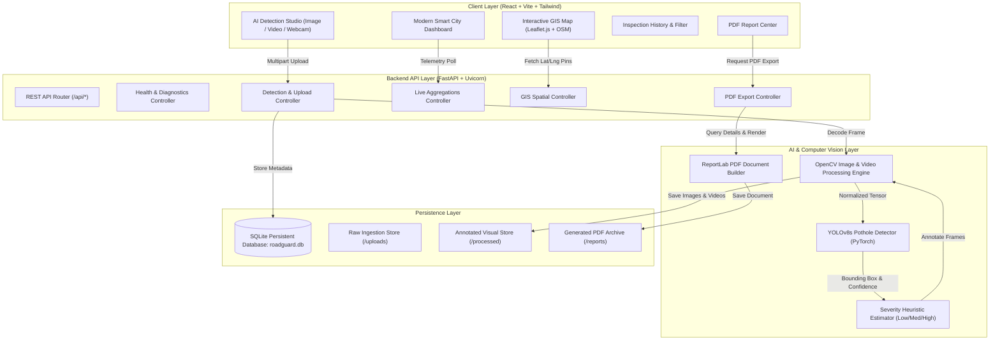
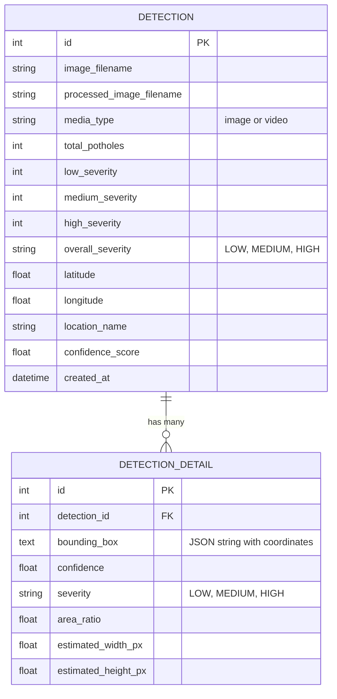

# RoadGuard AI - System Architecture & Technical Specifications

**Project Title:** AI-Based Pothole Detection and Road Monitoring System  
**Lab Track:** BTech Computer Science Next Generation Laboratory  
**Target Hardware:** Apple Silicon M2 (8GB Unified RAM, CPU/MPS Optimized)  

---

## 1. High-Level Architecture Overview

---

## 2. Pothole Severity Heuristic Mathematical Formulation

RoadGuard AI applies a geometric bounding-box area heuristic to estimate hazard urgency without claiming certified pavement structural engineering ratings:

### Primary Metrics:
1. **Area Occupancy Ratio ($A_{\text{ratio}}$):**
   $$A_{\text{ratio}} = \frac{W_{\text{box}} \times H_{\text{box}}}{W_{\text{frame}} \times H_{\text{frame}}}$$

2. **Maximum Span Ratio ($D_{\text{max}}$):**
   $$D_{\text{max}} = \max\left(\frac{W_{\text{box}}}{W_{\text{frame}}}, \frac{H_{\text{box}}}{H_{\text{frame}}}\right)$$

### Decision Boundary Matrix:
* **HIGH Severity ($A_{\text{ratio}} \ge 0.060 \lor D_{\text{max}} \ge 0.30$):**
  * *Color:* Crimson Red (`#EF4444`)
  * *Action:* Emergency cold-patch resurfacing within 24–48 hours to avert tire blowouts or cyclist accidents.
* **MEDIUM Severity ($A_{\text{ratio}} \ge 0.015 \lor D_{\text{max}} \ge 0.14$):**
  * *Color:* Amber Orange (`#F59E0B`)
  * *Action:* Scheduled routine asphalt filling during weekly municipal maintenance.
* **LOW Severity (Otherwise):**
  * *Color:* Emerald Green (`#10B981`)
  * *Action:* Logged for observation in quarterly resurfacing audits.

---

## 3. Database Schema (SQLite + SQLAlchemy ORM)

---

## 4. Video Detection Streaming Pipeline

1. **Stream Extraction:** Video is read sequentially frame-by-frame using `cv2.VideoCapture` to avoid buffering large files in RAM.
2. **Frame Sampling Stride:** Inference is triggered on every $N$-th frame (default $N=2$) to maintain high throughput on low-memory 8GB Apple Silicon.
3. **Keyframe Capture:** The frame exhibiting the highest pothole concentration is automatically captured, saved as a high-resolution thumbnail, and embedded into the official PDF compliance report.
4. **Encoding:** Processed frames are re-encoded with color-coded bounding boxes and top HUD banners using `mp4v` codec.
